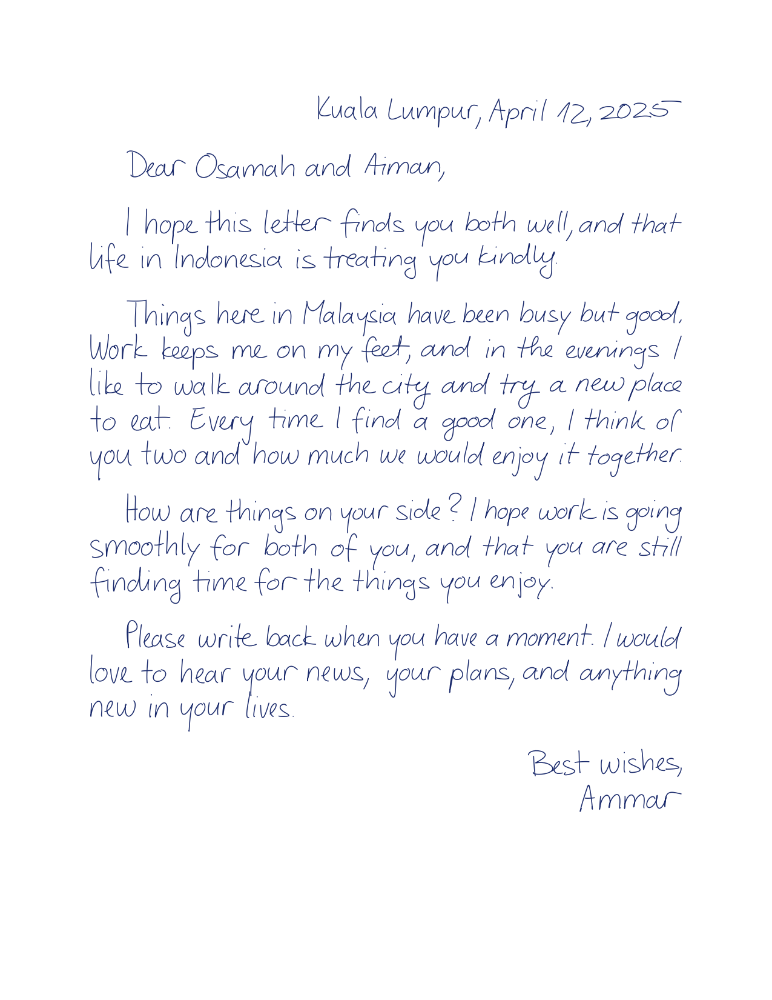
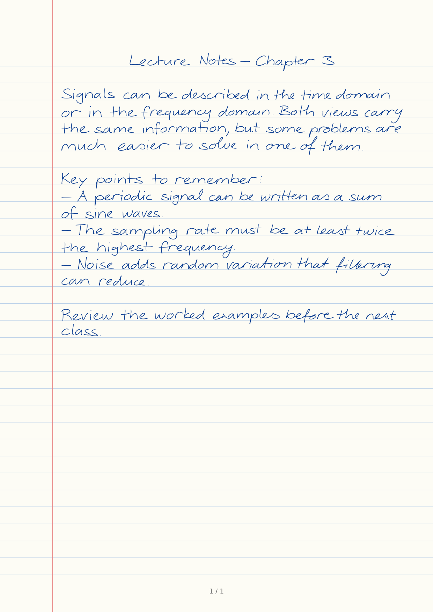
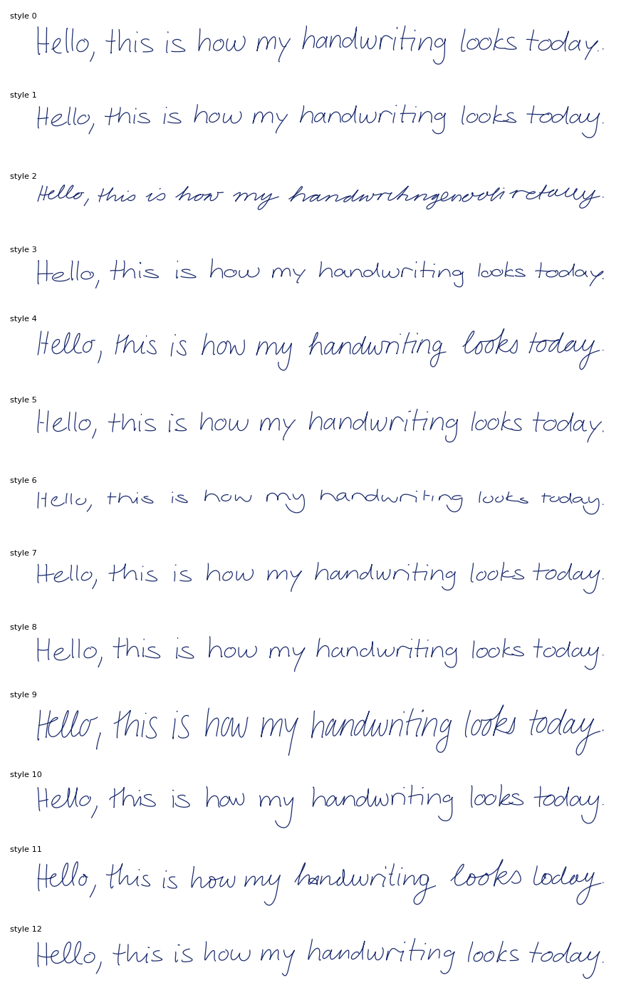

# Handwriting Page Generator

Turn any text into realistic **handwritten pages**: letters, notes, essays, or whole documents. You choose the paper size, the margins, how the text is aligned (including **full justification**, like `Ctrl + J` in Word), the line spacing, ruled notebook paper, the ink colour, the pen thickness, and one of 13 handwriting styles.

The output is a ready-to-print **PDF**, plus **PNG** images and editable **SVG** vector files.

<p align="center">
  
  
</p>

---

## Contents

1. [Features](#features)
2. [Installation](#installation)
3. [Your first page](#your-first-page)
4. [Writing your own text](#writing-your-own-text)
5. [Changing how the page looks](#changing-how-the-page-looks)
6. [All settings](#all-settings)
7. [Fixing a line you do not like](#fixing-a-line-you-do-not-like)
8. [Handwriting styles](#handwriting-styles)
9. [Using it from Python](#using-it-from-python)
10. [Tips and limitations](#tips-and-limitations)
11. [Credits](#credits)

---

## Features

- **Alignment:** justify (both edges straight), left, right, or center, set for the whole page or per paragraph.
- **Paper sizes:** Letter, Legal, A3, A4, A5, B5, Executive, or any custom size in inches or millimetres.
- **Portrait or landscape**, with separate top, bottom, left and right margins.
- **Notebook look:** ruled lines, a red margin line, a coloured paper background, and page numbers.
- **Pen control:** any ink colour, pen thickness, 13 handwriting styles, and a neatness level from messy to very neat.
- **Spacing:** line spacing, space between paragraphs, and first-line indent.
- **Automatic pages:** long texts flow onto as many pages as needed, and you can force a new page anywhere.
- **Fix single lines:** rewrite only the lines you do not like, choose the best version, and keep everything else.
- **Same result every time:** set a seed number to reproduce a page exactly.
- **Outputs:** multi-page PDF, PNG (any resolution), and SVG.

---

## Installation

You need **Python 3.9, 3.10 or 3.11** (tested with 3.9 on Windows). Download it from [python.org](https://www.python.org/downloads/) if you do not have it. On Windows, tick **"Add Python to PATH"** during installation.

### Option A: Windows, one click

1. Download this project: click the green **Code** button at the top of this page, then **Download ZIP**, and unzip it.
2. Double-click **`setup_windows.bat`**. It creates a private environment in a folder called `.venv` and installs everything. This takes a few minutes the first time.

### Option B: any system, using the terminal

```bash
git clone https://github.com/Ammarhmm6/handwriting-page-generator.git
cd handwriting-page-generator
python -m venv .venv
```

Activate the environment:

| System | Command |
|---|---|
| Windows (PowerShell) | `.venv\Scripts\Activate.ps1` |
| Windows (Command Prompt) | `.venv\Scripts\activate.bat` |
| macOS / Linux | `source .venv/bin/activate` |

Then install the requirements:

```bash
pip install -r requirements.txt
```

> **Important:** always run the commands from inside the project folder. If you see an error such as *"The module '.venv' could not be loaded"*, your terminal is in a different folder. Use `cd` to go to the project folder first.

---

## Your first page

With the environment activated, run:

```bash
python handwrite.py examples/letter.txt --settings examples/settings_letter.json
```

Your pages appear in the **`output`** folder:

| File | What it is |
|---|---|
| `output/letter.pdf` | All pages in one PDF, ready to print |
| `output/letter-page-1.png` | One image per page |
| `output/letter.lines.txt` | Every written line with its number (used to fix lines) |

If you did not activate the environment, call its Python directly instead:

```bash
# Windows
.venv\Scripts\python handwrite.py examples/letter.txt
# macOS / Linux
.venv/bin/python handwrite.py examples/letter.txt
```

---

## Writing your own text

1. Create a plain text file, for example `my_text.txt`, and type or paste your text into it.
2. Run:

```bash
python handwrite.py my_text.txt
```

The result is saved as `output/my_text.pdf`. To choose another name or folder, use `--out`:

```bash
python handwrite.py my_text.txt --out output/homework
```

### How the text file works

- **Each paragraph is one line in the file.** Long paragraphs are wrapped automatically.
- **An empty line** adds space between paragraphs.
- Lines that follow each other with no empty line start on a new line with no extra space, which is good for lists.
- **Per-paragraph alignment:** start a line with a tag:

| Tag | Result |
|---|---|
| `[right] April 12, 2025` | right-aligned, good for dates and signatures |
| `[center] My Title` | centered, good for headings |
| `[left] Some text` | left-aligned |
| `[justify] Some text` | justified |

- **New page:** put `[page]` alone on a line.

Example (`examples/letter.txt`):

```text
[right] Kuala Lumpur, April 12, 2025

Dear Osamah and Aiman,

I hope this letter finds you both well, and that life in Indonesia ...

[right] Best wishes,
[right] Ammar
```

### Characters

The handwriting can draw letters, digits, spaces and these symbols: `! " # ' ( ) , - . : ; ?`

Other characters are replaced automatically: `[ ]` become `( )`, `/` becomes `-`, `&` becomes `and`, curly quotes become straight quotes, and so on. The capital letters **Q, X and Z** are written in lower case because the handwriting cannot draw them as capitals.

---

## Changing how the page looks

There are two ways to change settings, and you can combine them.

### 1. A settings file (recommended)

Settings files are small JSON files. You only include what you want to change; everything else keeps its default. Three ready-made files are in the `examples` folder:

| File | Look |
|---|---|
| `settings_letter.json` | Letter paper, justified, indented paragraphs, dark-blue ink |
| `settings_notebook.json` | A4 ruled notebook paper, red margin line, page numbers, blue ink |
| `settings_black_ink.json` | A4, justified, black ink, wider lines |

```bash
python handwrite.py my_text.txt --settings examples/settings_notebook.json
```

Copy one, rename it (for example `my_settings.json`), and edit it in any text editor:

```json
{
  "page": {
    "size": "a4",
    "unit": "mm",
    "margin_left": 25,
    "margin_right": 20,
    "ruled_lines": true
  },
  "text": {
    "align": "justify",
    "line_spacing": 1.5
  },
  "pen": {
    "style": 7,
    "color": "black",
    "thickness": 1.2
  }
}
```

### 2. Quick changes from the command line

Use `--set section.setting=value`. You can repeat it as many times as you like:

```bash
python handwrite.py my_text.txt --set page.size=a4 --set text.align=left --set pen.color=black
```

More examples:

```bash
# double spacing on ruled paper
python handwrite.py my_text.txt --set text.line_spacing=2 --set page.ruled_lines=true

# landscape A5 card with centered text in red ink
python handwrite.py my_text.txt --set page.size=a5 --set page.orientation=landscape --set text.align=center --set pen.color=darkred

# custom 150 x 200 mm page
python handwrite.py my_text.txt --set page.size=custom --set page.unit=mm --set page.width=150 --set page.height=200

# only a high-resolution PNG
python handwrite.py my_text.txt --set output.formats=["png"] --set output.dpi=300
```

### Change the page without rewriting the text

Each run writes new handwriting. To try different paper, colours, margins or alignment **on the same handwriting**, add `--keep-writing`:

```bash
python handwrite.py my_text.txt --keep-writing --set page.ruled_lines=true --set pen.color=black
```

This works as long as the text and `text.chars_per_line` have not changed.

To see every setting and its current value:

```bash
python handwrite.py --show-settings
python handwrite.py --show-settings --settings my_settings.json
```

---

## All settings

### `page`: the paper

| Setting | Default | Description |
|---|---|---|
| `size` | `"letter"` | `letter`, `legal`, `a3`, `a4`, `a5`, `b5`, `executive`, or `custom` |
| `width`, `height` | `8.5`, `11` | Page size when `size` is `custom` (in `unit`) |
| `unit` | `"in"` | Unit for sizes, margins and indent: `in`, `mm` or `cm` |
| `orientation` | `"portrait"` | `portrait` or `landscape` |
| `margin_top` | `1.0` | Space above the first line |
| `margin_bottom` | `1.0` | Space below the last line |
| `margin_left` | `1.0` | Left margin |
| `margin_right` | `1.0` | Right margin |
| `paper_color` | `"#ffffff"` | Background colour, e.g. `"#fdfcf5"` for cream paper |
| `ruled_lines` | `false` | Draw notebook lines under the writing |
| `rule_color` | `"#b8cfe8"` | Colour of the ruled lines |
| `rule_thickness` | `0.6` | Thickness of the ruled lines (points) |
| `margin_line` | `false` | Vertical line on the left, like school paper |
| `margin_line_color` | `"#e88080"` | Colour of the margin line |
| `page_numbers` | `false` | Print page numbers at the bottom |
| `page_number_format` | `"{n} / {total}"` | Page number text, e.g. `"Page {n}"` |
| `page_number_color` | `"#666666"` | Page number colour |

### `text`: layout of the writing

| Setting | Default | Description |
|---|---|---|
| `align` | `"justify"` | `justify`, `left`, `right` or `center` |
| `chars_per_line` | `50` | About how many characters fit on one line. **Fewer = bigger handwriting.** Maximum 60 |
| `line_spacing` | `1.0` | `1.0` normal, `1.5` one-and-a-half, `2.0` double |
| `paragraph_spacing` | `0.5` | Extra space for each empty line, measured in lines |
| `indent` | `0` | First-line indent for each paragraph (in `unit`), e.g. `0.4` inches |
| `justify_last_line` | `false` | Also stretch the last line of each paragraph to both edges |

### `pen`: the handwriting

| Setting | Default | Description |
|---|---|---|
| `style` | `0` | Handwriting style from `0` to `12` (see below) |
| `neatness` | `2.0` | `0.3` = loose and varied, `1.0` = natural, `2.0` = neat, `3.0` = very neat. Higher values make fewer mistakes |
| `color` | `"#1a2a6c"` | Ink colour: a name (`black`, `blue`, `darkred`) or a hex code |
| `thickness` | `1.0` | Pen width: `0.7` fine pen, `1.0` ballpoint, `2.0` marker |
| `slant_jitter` | `0` | Small random up/down shift of each line for a more natural look (try `1`) |

### `output`: files

| Setting | Default | Description |
|---|---|---|
| `formats` | `["pdf", "png"]` | Any combination of `"pdf"`, `"png"`, `"svg"` |
| `dpi` | `150` | PNG resolution (300 for printing) |
| `seed` | `null` | Any whole number makes the handwriting identical on every run |

---

## Fixing a line you do not like

Handwriting is generated freshly every time, so now and then a word comes out wrong, especially long numbers such as `00:56:45`. Fix only those lines:

**Step 1.** Open `output/<name>.lines.txt` to find the line number:

```text
  5  Things here in Malaysia have been busy but good.
  6  Work keeps me on my feet, and in the evenings I
```

**Step 2.** Write several versions of the bad lines (here lines 6 and 12, five versions each):

```bash
python handwrite.py my_text.txt --redo 6,12 --candidates 5
```

**Step 3.** Open `output/<name>-candidates.png`. Each version is labelled `line:version`, for example `6:3`.

**Step 4.** Keep the versions you like:

```bash
python handwrite.py my_text.txt --pick 6:3,12:1
```

Only those lines change; the rest of the page stays exactly the same. To simply rewrite lines without choosing, use `--redo 6,12` on its own.

---

## Handwriting styles

Run this to make a sheet of all 13 styles in `output/styles.png`:

```bash
python handwrite.py --preview-styles
```



Styles **0, 1, 3, 7 and 12** are the most reliable, especially for numbers.

---

## Using it from Python

```python
from handwriting_synthesis import Hand

hand = Hand()
hand.write(
    filename="output/simple.svg",
    lines=["Hello there,", "this line was written by hand."],
    biases=[2.0, 2.0],        # neatness
    styles=[0, 0],            # handwriting style
    stroke_colors=["black", "navy"],
    stroke_widths=[1, 2],
)
```

`hand.write` gives a simple SVG with one centered line per row and no page layout. For full pages, use `handwrite.py`.

---

## Tips and limitations

- **Bigger or smaller writing:** change `text.chars_per_line`. `35` gives large writing; `60` gives small writing.
- **Justified text looks best** with 45 to 55 characters per line.
- **Numbers and times** (like `12:30:45`) are the hardest to write. Use a neat style (0, 7 or 12), `neatness` of 2 or more, and fix single lines as shown above.
- **Speed:** a full page takes a few minutes on a normal computer. No graphics card is needed.
- **Landscape pages** make the handwriting larger at the same `chars_per_line`. Raise it (up to 60) for a natural size.
- The first run prints a few TensorFlow notices. They are normal and can be ignored.

### Troubleshooting

| Problem | Solution |
|---|---|
| `The module '.venv' could not be loaded` | You are not in the project folder. `cd` into it first. |
| `No module named tensorflow` | Activate the environment, or run `pip install -r requirements.txt` again. |
| `running scripts is disabled on this system` (PowerShell) | Run `Set-ExecutionPolicy -Scope CurrentUser RemoteSigned` once, or use `.venv\Scripts\python` directly. |
| TensorFlow fails to install | Check your Python version with `python --version`. It must be 3.9, 3.10 or 3.11. |

---

## Project structure

```text
handwrite.py                 main program: text file -> handwritten pages
setup_windows.bat            one-click setup for Windows
requirements.txt             required Python packages
examples/                    sample texts and settings files
docs/                        pictures used in this guide
handwriting_synthesis/       handwriting model code (drawing, sampling, training)
model/checkpoint/            trained model weights
model/style/                 the 13 handwriting styles
```

To train your own model, see [model/README.md](model/README.md).

---

## Credits

This project builds on:

- **[sjvasquez/handwriting-synthesis](https://github.com/sjvasquez/handwriting-synthesis)** by Sean Vasquez, the original implementation and trained model.
- **[otuva/handwriting-synthesis](https://github.com/otuva/handwriting-synthesis)**, which ported that code to TensorFlow 2 with a cleaner structure. This project started from that version.
- The method comes from the paper [*Generating Sequences with Recurrent Neural Networks*](https://arxiv.org/abs/1308.0850) by Alex Graves (2013).
- The handwriting data comes from the [IAM On-Line Handwriting Database](https://fki.tic.heia-fr.ch/databases/iam-on-line-handwriting-database).

**New in this project:** full page layout with justified, left, right and centered alignment; paper sizes, orientation and margins; ruled paper, margin line, paper colour and page numbers; ink colour and pen thickness; settings files and command-line settings; automatic multi-page output to PDF, PNG and SVG; rewriting and choosing single lines; reusing handwriting with new page settings; clean-up of stray end-of-line marks; and a pinned, tested set of requirements.

The original repositories do not include a license. Please respect the rights of the original authors when reusing this code.

---

Ammar Al-Mekhlafi, 2025
